# Ubuntu Server Environment Setup, Hardening & Docker Deployment

Een praktische walkthrough voor het opzetten, beveiligen en beheren van een Ubuntu Server in VirtualBox. Dit project behandelt de installatie van de webserver (Nginx), containerisatie met Docker, databasebeheer met PostgreSQL, en geavanceerde SSH-beveiliging (Server Hardening & Public Key Authentication).

---

## 🛠️ Gebruikte Technologieën

* **Besturingssystemen:** Ubuntu Server (26.04 LTS), Fedora Workstation (Host)
* **Virtualisatie:** VirtualBox
* **Webservers:** Nginx (Native & Dockerized)
* **Containers & Databases:** Docker, PostgreSQL
* **Beveiliging & Beheer:** OpenSSH (ED25519), Fail2ban, Bash Scripting, System Logs (`auth.log`)

---

## 🚀 Project Overzicht & Stappenplan

### 1. Webserver Setup & Basisinformatie
* **Native Nginx:** Geïnstalleerd en live gezet op het IP-adres `192.168.56.101`.
* **Netwerkcontrole:** IP-adres geverifieerd via `ip a` op interface `enp0s8`.

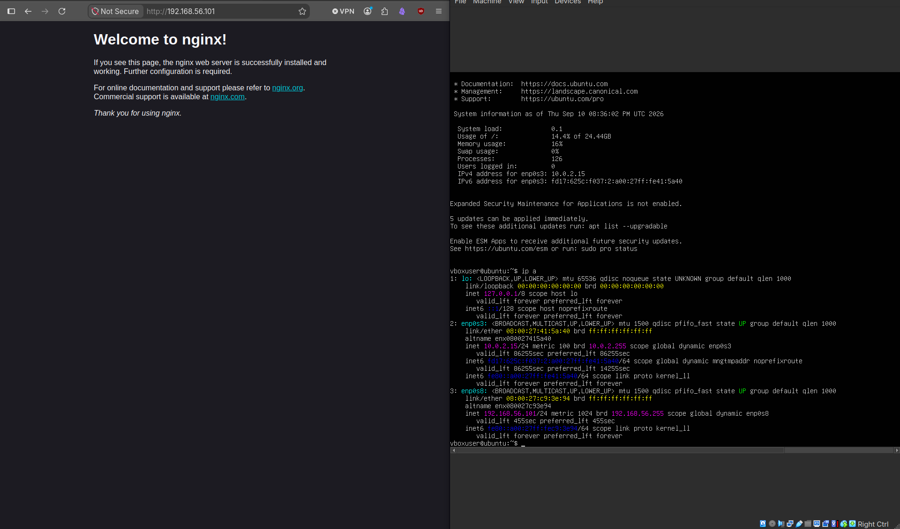

---

### 2. Custom Web Application & Port Mapping
* **Custom Web Application:** In `/var/www/html` de standaard Nginx-pagina vervangen door een eigen geschreven HTML-applicatie.
* **Port Mapping:** Nginx geconfigureerd om ook te luisteren op poort `8080`.

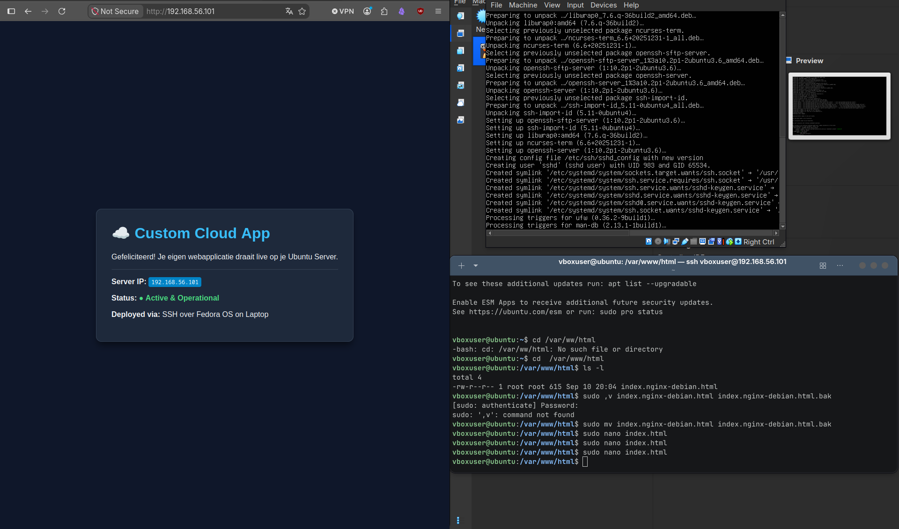
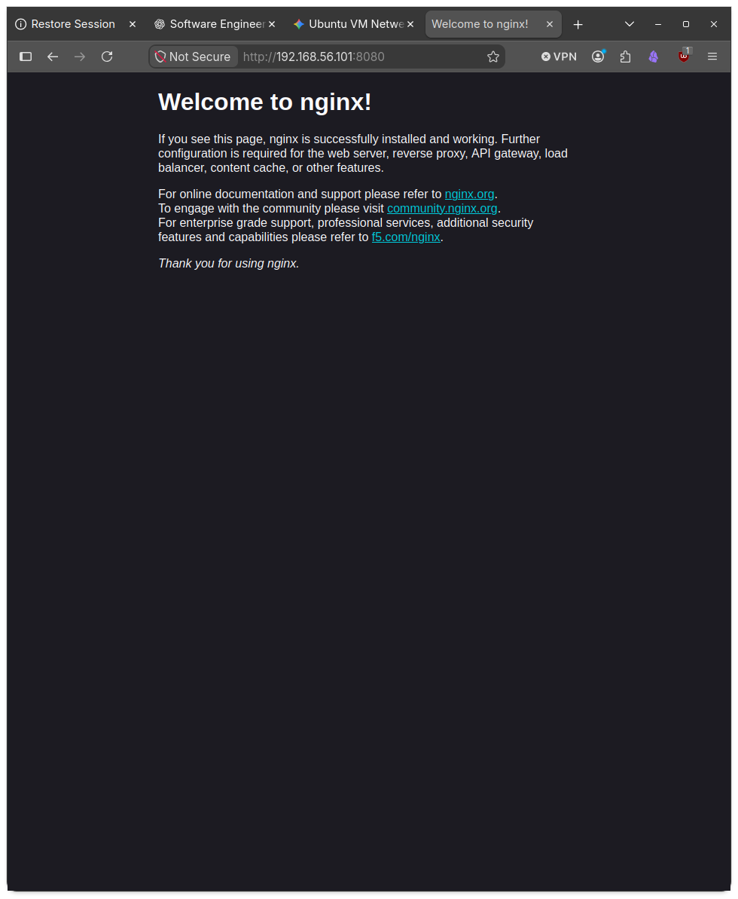

---

### 3. Containerisatie met Docker & PostgreSQL
* **PostgreSQL Database Container:** PostgreSQL-container opgestart via Docker.
* **Database Beheer:** Verbinding gemaakt met de container via `docker exec -it cloud-db psql -U postgres`.
* **SQL Uitvoering:** Relationale database opgebouwd en gevuld met gegevens via `CREATE TABLE users` en `INSERT INTO users`.

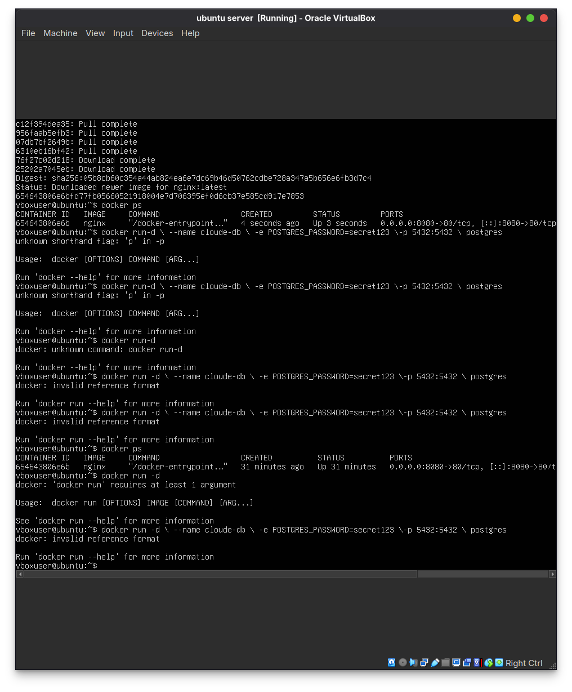
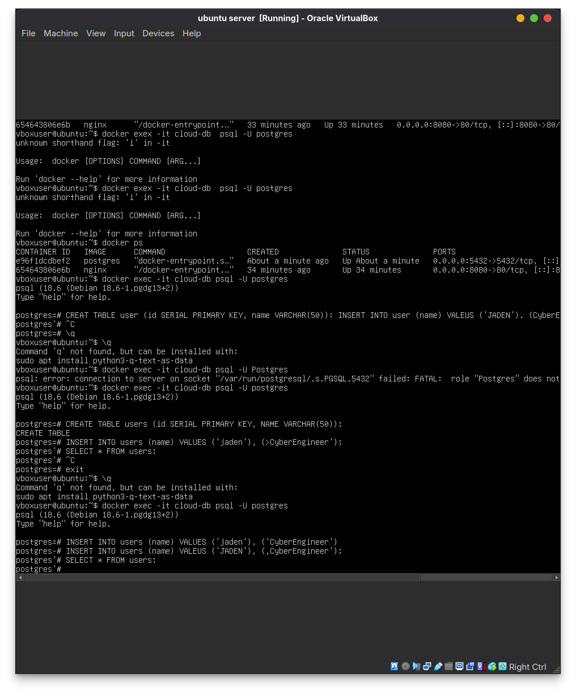

---

### 4. Linux Beveiliging, Monitoring & SSH Hardening
* **Log Monitoring:** Systeem- en authenticatielogs gemonitord via `sudo tail -n 20 /var/log/auth.log`.
* **Bruteforce Analyse:** Gecontroleerde inlogpogingen uitgevoerd om mislukte SSH-pogingen in `/var/log/auth.log` te analyseren.
* **Troubleshooting:** Netwerkfouten geanalyseerd bij SSH-verbindingsproblemen (`Connection refused`).
* **Fail2ban Beveiliging:** Actieve monitoring en status van de `sshd` jail gecontroleerd via `fail2ban-client`.
* **SSH Key-based Authentication:** ED25519 SSH-sleutel geconfigureerd en via `ssh-copy-id` naar de server gepusht.
* **Server Hardening:** Wachtwoord-authenticatie uitgeschakeld. Pogingen om via wachtwoord in te loggen (`ssh -o PubkeyAuthentication=no`) worden geweigerd met `Permission denied (publickey)`.

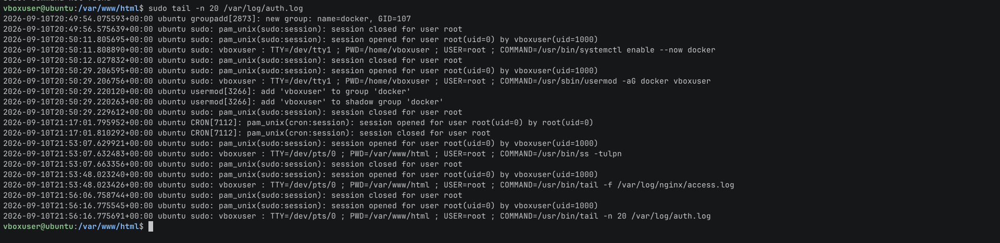
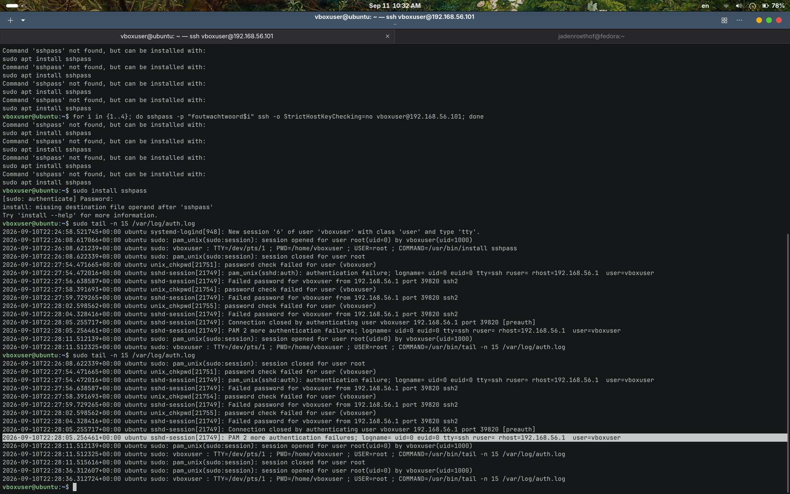

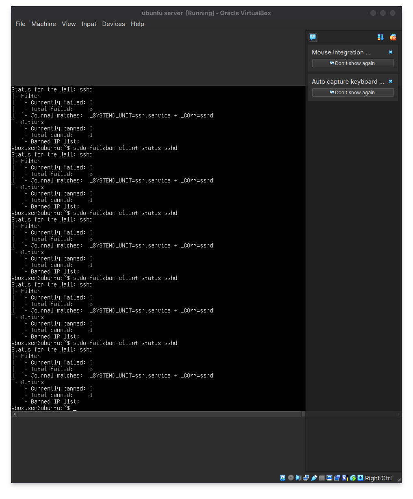
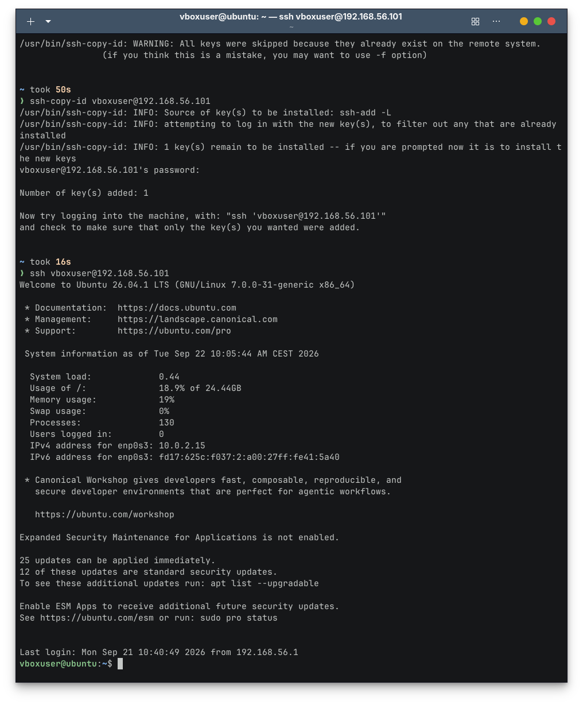
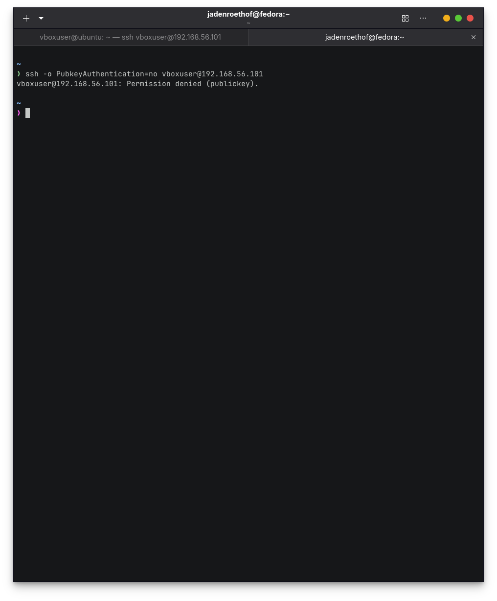

---

### 5. Troubleshooting & Container Logging
* Live verzoeken en statuscodes (`200 OK`, `404 Not Found`) gemonitord via de containerlogs (`docker logs`).

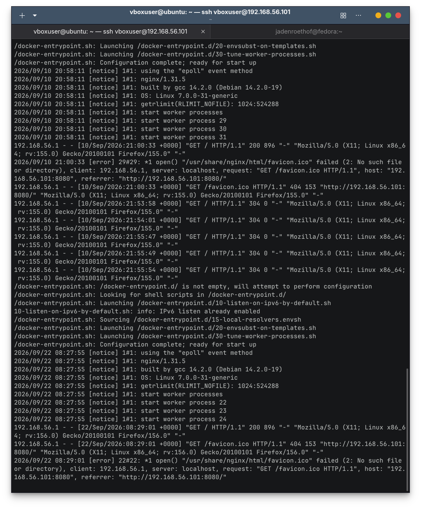

---

## 📌 Kerncommando's Referentie

```bash
# Docker Container Logs
docker logs -f <container_name>

# Fail2ban Status
sudo fail2ban-client status sshd

# Auth Log Monitoring
sudo tail -f /var/log/auth.log

# Testen of wachtwoord-inlog geblokkeerd is
ssh -o PubkeyAuthentication=no vboxuser@192.168.56.101
